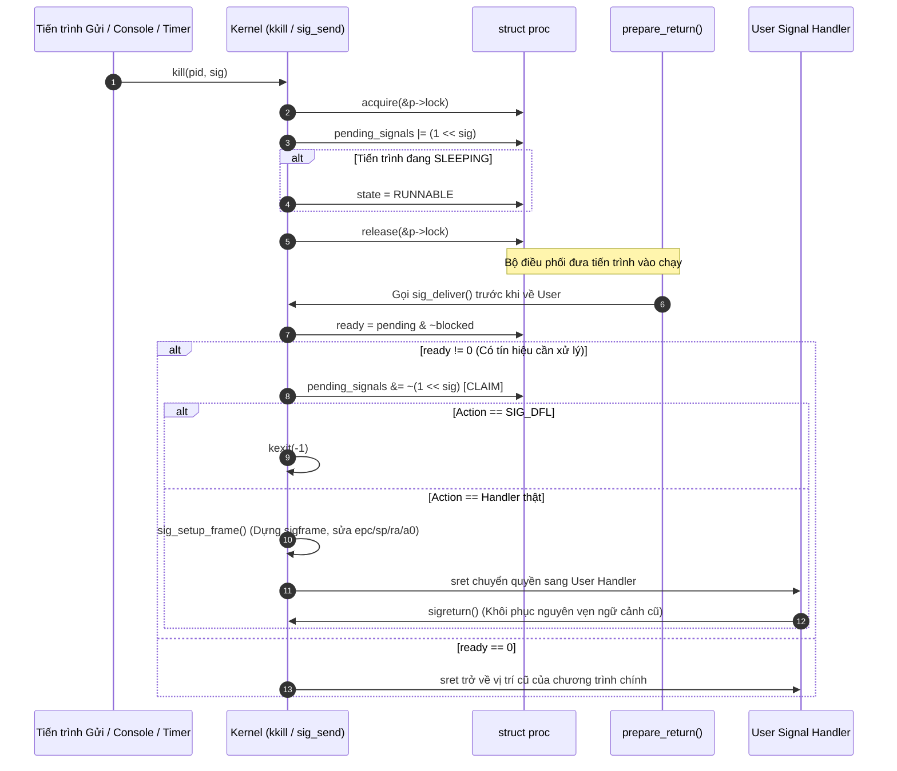

# Đặc tả Thiết kế Kỹ thuật: Signal Delivery & Sending

* **Thành viên phụ trách:** Phạm Lê Quyền  
* **Đề tài:** POSIX-style signals trên xv6-riscv (Mã đề tài: 26106)  
* **Vai trò module:** Quản lý hàng đợi tín hiệu đang chờ (`pending_signals`), cơ chế gửi tín hiệu bất đồng bộ (`kill`), lựa chọn tín hiệu và điều phối chuyển giao (`delivery`) từ kernel về user mode.

---

## 1. Bản chất Kiến trúc: Tại sao Signal cần cơ chế Hai Pha (Two-Phase)?

Tín hiệu (signal) là một cơ chế ngắt phần mềm (software interrupt) bất đồng bộ. Khi một tiến trình gọi `kill(pid, sig)` để gửi tín hiệu tới tiến trình đích:

> **Kernel tuyệt đối không thể chuyển ngay lập tức sang chạy hàm handler của tiến trình đích.**

Nguyên nhân kỹ thuật:
1. **Tiến trình đích có thể đang ngủ (`SLEEPING`):** Ví dụ tiến trình đang chờ dữ liệu từ đĩa hoặc console, nó chưa được CPU nạp vào thực thi.
2. **Tiến trình đích có thể đang chạy trong Kernel Context:** Nếu tiến trình đích đang thực hiện một system call quan trọng, việc ngắt ngang và ép chạy mã người dùng sẽ làm hỏng trạng thái kernel stack và gây đổ vỡ hệ thống.
3. **An toàn ranh giới đặc quyền (Privilege Boundary):** Không được phép thực thi mã người dùng (user code) khi CPU đang ở chế độ đặc quyền Supervisor mode.

Vì vậy, kiến trúc xử lý tín hiệu được chia thành **hai pha độc lập**:
- **Pha 1: Tiếp nhận và ghi nhận (Signal Sending/Enqueueing):** Khi `kill(pid, sig)` được gọi, kernel chỉ ghi nhận sự kiện bằng cách bật bit tương ứng trong `p->pending_signals` của tiến trình nhận, đồng thời đánh thức tiến trình đó nếu nó đang ngủ.
- **Pha 2: Chuyển giao và kích hoạt (Signal Delivery):** Khi tiến trình nhận được lập lịch chạy, hoàn thành công việc trong kernel và chuẩn bị quay trở lại user mode (`prepare_return`), kernel mới kiểm tra danh sách pending, chọn tín hiệu và chuyển hướng luồng thực thi sang handler.

---

## 2. Mô hình Dữ liệu và Nguyên tắc Đồng bộ (Synchronization)

### 2.1. Cấu trúc dữ liệu trong `struct proc` (`kernel/proc.h`)
```c
struct proc {
  // ... các trường gốc của xv6 ...
  
  // Được bảo vệ bởi p->lock:
  sigset_t pending_signals;            // Bitmask các tín hiệu đang chờ xử lý
  uint64 alarm_deadline;               // Hạn chót timer (ticks)

  // Dữ liệu Private của tiến trình (chỉ tiến trình hiện hành truy cập, không cần p->lock):
  sigset_t blocked_signals;            // Bitmask các tín hiệu đang bị chặn (mask)
  struct sigaction sig_actions[NSIG];  // Bảng cấu hình hành vi cho từng tín hiệu
};
```

### 2.2. Biểu diễn Bitmask và Quy ước Signal Number
Kiểu `sigset_t` là một số nguyên không dấu 32-bit (`uint32`):
- Các tín hiệu hợp lệ nằm trong khoảng: `1 <= sig < NSIG (32)`.
- Bit `0` không sử dụng.
- Tín hiệu số `sig` tương ứng với bit `(1U << sig)`. Ví dụ: `SIGHUP` (1) là bit 1, `SIGINT` (2) là bit 2, `SIGKILL` (9) là bit 9.
- **Đặc tính gộp (Coalescing):** Nếu cùng một tín hiệu được gửi nhiều lần liên tiếp khi tiến trình chưa kịp xử lý, bitmask chỉ giữ một bit `1`. Kernel không lưu hàng đợi vô hạn, ngăn chặn tràn bộ nhớ.

### 2.3. Quy tắc Khóa (Locking Invariant)
- **`pending_signals`:** Bắt buộc phải giữ `p->lock` khi đọc và ghi, vì trường này có thể bị ghi đồng thời bởi CPU khác (tiến trình khác gửi tín hiệu) hoặc bởi ngắt phần cứng (ngắt timer gửi `SIGALRM`).
- **`blocked_signals` và `sig_actions`:** Là dữ liệu riêng (private) của tiến trình. Chỉ bản thân tiến trình đó mới có quyền tự thay đổi mặt nạ hoặc handler của chính nó. Do đó, việc đọc bảng action và mask trong quá trình delivery không cần giữ `p->lock`, giảm tranh chấp khóa giữa các CPU.

---

## 3. Cơ chế Gửi Tín hiệu: `kkill(pid, sig)` và `sig_send(p, sig)`

### 3.1. Chữ ký System Call
- Phía user: `int kill(int pid, int sig);` (khai báo tại `user/user.h`).
- Phía kernel: `int kkill(int pid, int sig);` (khai báo tại `kernel/defs.h`).
- System call dispatcher: `sys_kill()` trong `kernel/sysproc.c` trích xuất `pid` và `sig` từ thanh ghi `a0`, `a1` rồi gọi `kkill()`.

### 3.2. Thuật toán xử lý trong Kernel
```text
kkill(pid, sig):
    1. Kiểm tra tham số:
       - pid <= 0: từ chối (xv6 baseline không hỗ trợ process group).
       - sig <= 0 || sig >= NSIG: từ chối số hiệu tín hiệu không hợp lệ.
       -> Nếu sai, trả về -1.

    2. Duyệt bảng tiến trình proc[]:
       - Lấy p->lock của từng slot.
       - Kiểm tra: p->pid == pid VÀ p->state != UNUSED VÀ p->state != ZOMBIE.
       - Nếu tìm thấy:
           a. Nếu sig == SIGKILL:
              - Đặt p->killed = 1 (giữ nguyên đường xử lý gốc của xv6 để diệt tiến trình dứt điểm).
              - Nếu p->state == SLEEPING: chuyển sang RUNNABLE.
              - Nhả p->lock và trả về 0.
           b. Nếu là tín hiệu khác:
              - Gọi sig_send(p, sig):
                  + Bật bit: p->pending_signals |= (1U << sig);
                  + Xóa p->chan = 0 (tránh wakeup() cũ trên kênh chờ đánh thức nhầm sau này).
                  + Nếu p->state == SLEEPING: chuyển p->state = RUNNABLE (đánh thức tiến trình).
              - Nhả p->lock và trả về 0.
       - Nhả p->lock nếu PID không khớp.

    3. Nếu duyệt hết bảng không tìm thấy PID hợp lệ: trả về -1.
```

**Điểm kỹ thuật mấu chốt:** Việc đánh thức tiến trình đang `SLEEPING` sang `RUNNABLE` là bắt buộc. Nếu không có bước này, một tiến trình đang gọi `pause()` hoặc chờ I/O sẽ tiếp tục ngủ mãi mãi và không bao giờ thức dậy để nhận tín hiệu.

---

## 4. Cơ chế Chuyển giao Tín hiệu: `sig_deliver()` tại `prepare_return()`

### 4.1. Vị trí Kích hoạt Delivery
Trong `kernel/trap.c`, hàm `prepare_return()` là trạm kiểm soát cuối cùng trước khi CPU chuyển giao quyền kiểm soát từ kernel về user mode. Vị trí này áp dụng cho:
- Sau khi hoàn thành một system call.
- Sau khi xử lý xong một ngắt thiết bị hoặc ngắt timer (sau khi đã `yield()`).
- Sau khi tiến trình con mới sinh ra thoát khỏi `forkret()`.

Tại đây, kernel gọi `sig_deliver()` trước lệnh tắt ngắt `intr_off()`.

### 4.2. Thuật toán Điều phối Delivery
```text
sig_deliver():
    p = myproc()
    Nếu không có tiến trình hoặc p->killed == 1:
        kexit(-1) // Ưu tiên kết thúc ngay nếu đã bị đánh dấu killed

    1. LỰA CHỌN TÍN HIỆU (Signal Selection):
       - Giữ p->lock.
       - Tính tập tín hiệu sẵn sàng:
             ready = p->pending_signals & SUPPORTED_MASK & ~sig_sanitize(p->blocked_signals);
       - Nếu ready == 0:
             Nhả p->lock, kết thúc sig_deliver (tiếp tục quay về chương trình chính).
       - Chọn signal nhỏ nhất:
             Duyệt từ bit 1 đến 31, lấy số hiệu i đầu tiên có bit bật.
       
       - CLAIM TÍN HIỆU (Quan trọng):
             Xóa bit khỏi hàng chờ ngay lập tức: p->pending_signals &= ~(1U << i);
       - Nhả p->lock.

    2. XỬ LÝ HÀNH VI (Action Dispatching):
       - Đọc cấu hình: act = p->sig_actions[i];
       
       - Trường hợp 1: act.sa_handler == SIG_IGN (Bỏ qua)
             Bỏ signal này và QUAY LẠI bước 1 để xét signal pending kế tiếp
             (sig_deliver là một vòng lặp — tránh để signal sẵn sàng khác bị
             kẹt tới lần trở về user sau).
             (Lưu ý: SIGKILL không bao giờ rơi vào đây do không thể bị set SIG_IGN).

       - Trường hợp 2: act.sa_handler == SIG_DFL (Hành vi mặc định)
             Theo quy ước thiết kế D5: hầu hết tín hiệu mặc định kết thúc tiến trình:
             kexit(-1);

       - Trường hợp 3: act.sa_handler là hàm do người dùng cài đặt
             Gọi sang module Handler của Hưng để dựng khung stack:
                 res = sig_setup_frame(i, &act);
             Nếu res < 0 (lỗi bộ nhớ, hỏng user stack):
                 kexit(-1); // Kết thúc ngay để tránh sập kernel
             Nếu res == 0:
                 Kết thúc sig_deliver. CPU sẽ nhảy vào thực thi Handler của người dùng!
```

### 4.3. Tại sao phải "Claim Tín hiệu" trước khi dựng Frame?
Thao tác xóa bit `p->pending_signals &= ~(1U << i)` diễn ra dưới `p->lock` ngay trước khi nhả khóa để gọi `sig_setup_frame()`.
- **Nếu xóa trước:** Trong quá trình kernel dựng frame trên user stack (thao tác `copyout` có thể tốn thời gian), nếu một CPU khác gửi tiếp tín hiệu cùng loại, bit pending sẽ được bật lại an toàn và sẽ được xử lý ở lần trở về tiếp theo.
- **Nếu xóa sau:** Tín hiệu mới đến trong lúc dựng frame sẽ bị ghi đè, và sau đó lệnh xóa hoàn tất sẽ xóa mất tín hiệu mới đó, gây ra hiện tượng thất thoát tín hiệu (Signal Dropping).

---

## 5. Ngắt System Call đang chờ: `sig_interrupted()`

### 5.1. Vấn đề
Bản gốc xv6 chỉ kiểm tra `p->killed` trong các vòng chờ (`while (...) { if (killed(p)) return -1; sleep(...); }`). `sig_send()` có đánh thức tiến trình (`SLEEPING → RUNNABLE`), nhưng vì `killed == 0` với các signal thường, tiến trình **ngủ lại ngay**: `SIGTERM`, `SIGUSR1`… không bao giờ được giao cho tiến trình đang chờ `read()` / `wait()` / `pause()`. Chỉ `SIGKILL` ngắt được.

### 5.2. Giải pháp
Hàm mới trong `kernel/proc.c` (khai báo ở `kernel/defs.h`):

```c
int sig_interrupted(struct proc *p);
// = 1 nếu p->killed, HOẶC có signal pending, KHÔNG bị chặn, và handler != SIG_IGN
```

Thay `killed()` bằng `sig_interrupted()` tại **5 điểm chờ**:

| Điểm chờ | File | Khóa đang giữ khi gọi |
|---|---|---|
| `consoleread` | `kernel/console.c` | `cons.lock` |
| `piperead` | `kernel/pipe.c` | `pi->lock` |
| `pipewrite` | `kernel/pipe.c` | `pi->lock` |
| `kwait` | `kernel/proc.c` | `wait_lock` |
| `sys_pause` | `kernel/sysproc.c` | `tickslock` |

`killed()` trong `kernel/trap.c` **giữ nguyên**: ở đó nó dùng để kết thúc tiến trình bị `SIGKILL`.

### 5.3. Hành vi
1. Syscall đang chờ nhả khóa và trả `-1` (tương đương `EINTR` của POSIX).
2. Trên đường về user, `prepare_return()` → `sig_deliver()` giao signal:
   * `SIG_DFL` → `kexit(-1)`.
   * Handler → chạy handler, sau `sigreturn()` chương trình tiếp tục với giá trị trả về `-1` của syscall.
3. Signal **đang bị chặn** hoặc **bị `SIG_IGN`** không làm `sig_interrupted()` trả 1 ⇒ syscall tiếp tục chờ bình thường (DL-09, DL-12).

### 5.4. Race "lost wakeup" với `sleep_prepare()` / `sleep()` (Tuần 3)

Bản xv6 này không dùng `sleep(chan, lk)` cổ điển mà tách làm hai bước:

```c
sleep_prepare(chan);   // dưới p->lock: p->chan = chan
release(cond_lock);    // nhả khóa điều kiện (pi->lock, cons.lock, ...)
sleep();               // dưới p->lock: chỉ ngủ nếu p->chan != 0
```

`wakeup(chan)` báo "đã có sự kiện" bằng cách **xóa `p->chan = 0`**; nhờ vậy `sleep()` biết để không ngủ nữa. Vòng chờ có signal trông như sau:

```c
while (chưa có dữ liệu) {
  if (sig_interrupted(p)) { release(lk); return -1; }  // (1) kiểm tra signal
  sleep_prepare(chan);                                  // (2) đặt p->chan
  release(lk);
  sleep();                                              // (3) ngủ nếu p->chan != 0
  acquire(lk);
}
```

Có **hai khe** mà signal đến sẽ bị mất (tiến trình ngủ dù signal đang chờ):

| Signal đến lúc | Vấn đề | Cách sửa | Ai sửa |
|---|---|---|---|
| Giữa (2) và (3) | Tiến trình đang `RUNNING` nên `sig_send()` không đổi state; `p->chan` vẫn ≠ 0 ⇒ (3) ngủ luôn | `sig_send()` và nhánh `SIGKILL` của `kkill()` xóa **`p->chan = 0`** giống `wakeup()` ⇒ (3) không ngủ, vòng lặp quay lại (1) | Commit `7d73a0a` |
| Giữa (1) và (2) | `sig_send()` xóa `p->chan` nhưng ngay sau đó (2) **gán lại** `p->chan` ≠ 0 ⇒ (3) ngủ luôn | Gộp (1) và (2) làm **một bước nguyên tử** dưới cùng một lần giữ `p->lock`: hàm mới `sleep_prepare_intr(chan)` — nếu đã có signal cần giao thì **không** đặt `p->chan` và trả 1 | Tuần 3 — Quyền |

```c
// kernel/proc.c
int sleep_prepare_intr(void *chan)
{
  acquire(&p->lock);
  r = sig_deliverable_locked(p);   // cùng điều kiện với sig_interrupted()
  if (!r) p->chan = chan;
  release(&p->lock);
  return r;                        // 1 => có signal, không ngủ
}
```

Tại 5 điểm chờ, `sleep_prepare(chan)` được thay bằng:

```c
if (sleep_prepare_intr(chan))
  continue;            // quay lại đầu vòng: (1) thấy signal -> return -1
```

Vì `sig_send()` cũng chạy dưới `p->lock`, mọi signal hoặc đến **trước** bước nguyên tử (bị phát hiện, không ngủ) hoặc **sau** (xóa `p->chan`, `sleep()` không ngủ) ⇒ không còn khe nào.

**Kiểm chứng (fault injection):** chèn tạm vòng trễ giữa (1) và (2) trong `piperead` để mở rộng khe, chạy 300 vòng "con vừa vào `read()` thì cha gửi `SIGUSR1`" trên `CPUS=4`:

| Phiên bản kernel (có chèn trễ) | Số lần mất wakeup / 300 |
|---|---|
| `main@9880d92` (đã có `p->chan = 0`) | **7** |
| + `sleep_prepare_intr()` | **0** |

Bản chính thức (không chèn trễ) được kiểm tra bằng `killtest` Test 10: 500 vòng, 0 lần mất wakeup.

### 5.5. Thứ tự khóa
Mọi điểm gọi đều theo chiều **khóa điều kiện → `p->lock`**, cùng chiều với `sleep_prepare()`/`wakeup()` gốc ⇒ không phát sinh deadlock. Phân tích đầy đủ: [`signal-core-locking.md`](signal-core-locking.md).

---

## 6. Tương tác với Phím Ctrl+C từ Bàn phím Console

> Phần hiện thực luồng `Ctrl-C → SIGINT` và quản lý `fgpid` do Nguyễn Trung Kiên phụ trách từ tuần 3. Module Delivery chỉ cung cấp `kkill(pid, SIGINT)` và cơ chế ngắt `consoleread` qua `sig_interrupted()`.


Nhằm hiện thực hóa kịch bản người dùng nhấn `Ctrl+C` để ngắt chương trình đang chạy trong console:
1. Khi bàn phím gửi ký tự `0x03` (`ETX` - End of Text), hàm `consoleintr()` trong `kernel/console.c` nhận diện được sự kiện này.
2. Kernel tìm kiếm tiến trình đang chạy ở tiền cảnh (foreground process) gắn liền với console.
3. Kernel gọi `kkill(target_pid, SIGINT)` để gửi tín hiệu ngắt.
4. Nếu tiến trình đã đăng ký handler cho `SIGINT`, hàm xử lý sẽ được gọi; nếu chưa đăng ký (`SIG_DFL`), tiến trình sẽ dừng lại sạch sẽ qua `kexit(-1)`.

---

## 7. Sơ đồ Luồng Thực thi (Execution Flow)



---

## 8. Ma trận Kiểm thử Module Delivery (DL-01 đến DL-16)

Toàn bộ ca kiểm thử nằm trong `user/killtest.c` (chạy: `$ killtest` trong shell xv6).

| Mã Test | Tình huống kiểm thử | Hành động & Dữ liệu đầu vào | Kết quả mong đợi | Test trong `killtest` |
|---|---|---|---|---|
| **DL-01** | Gửi tín hiệu thông thường | Gửi `SIGUSR1` tới tiến trình có handler | Handler chạy thành công, không làm crash tiến trình | T10 |
| **DL-02** | Tín hiệu bị chặn (Masked) | Chặn `SIGUSR1`, sau đó gửi `SIGUSR1` | Handler chưa chạy; bit tồn tại trong `pending_signals` | T7 |
| **DL-03** | Delivery sau khi Unmask | Tiếp tục từ DL-02, mở chặn `SIGUSR1` | Handler được gọi thực thi ngay sau khi unmask | T7 |
| **DL-04** | Gộp tín hiệu lặp lại | Chặn `SIGUSR1`, gửi 5 lần (từ chính mình và từ tiến trình khác), mở chặn | Handler chỉ chạy đúng 1 lần duy nhất | T7 |
| **DL-05** | Thứ tự ưu tiên tín hiệu | Chặn cả hai, gửi `SIGUSR2` (12) rồi `SIGUSR1` (10), mở chặn cùng lúc | `SIGUSR1` có số hiệu nhỏ hơn được delivery trước | T8 |
| **DL-06** | Gửi tới PID không tồn tại | Gọi `kill(99999, SIGUSR1)`, `kill(0, …)`, `kill(-5, …)` | Syscall trả về `-1`, kernel hoạt động ổn định | T2 |
| **DL-07** | Số hiệu tín hiệu sai | Gọi `kill(pid, 0)`, `-1`, `32`, `1000` | Syscall trả về `-1` | T1 |
| **DL-08** | Hành vi mặc định `SIG_DFL` | Không đặt handler, gửi `SIGUSR1` / `SIGTERM` | Tiến trình kết thúc ngay lập tức với exit code -1 | T5, T6 |
| **DL-09** | Hành vi bỏ qua `SIG_IGN` | Đặt `SIG_IGN` cho `SIGUSR1`, gửi khi đang chờ `read()` | Tín hiệu bị tiêu thụ, `read()` không bị ngắt, tiến trình chạy tiếp | T9 |
| **DL-10** | Đánh thức tiến trình SLEEPING | Con chờ trên `read()` pipe; cha gửi `SIGKILL` / `SIGTERM` / `SIGUSR1` có handler; lặp 500 vòng gửi đúng lúc con vừa vào `read()` | Con được đánh thức; `SIG_DFL` → thoát `-1`; có handler → `read()` trả `-1`, handler chạy, con chạy tiếp; **0 lần mất wakeup** | T4, T6, T10 |
| **DL-11** | Bắt ngắt Ctrl+C | Chương trình chạy lặp vô tận, nhấn Ctrl+C | `SIGINT` kích hoạt handler thành công | Chờ luồng Ctrl-C (Kiên) |
| **DL-12** | Signal bị chặn không ngắt syscall | Chặn `SIGUSR2`, đang chờ `read()`, gửi `SIGUSR2` rồi ghi dữ liệu | `read()` vẫn chờ và nhận đúng dữ liệu | T12 |
| **DL-13** | Stress đa CPU | `CPUS=4`: 4 tiến trình × 200 `kill()` đồng thời; 4 tiến trình cùng `SIGKILL` 4 nạn nhân | Không mất bit pending, không panic / deadlock | T11 |
| **DL-14** | Gửi tới tiến trình ZOMBIE | Con `exit(7)` ngay, cha chưa `wait`, gửi `SIGUSR1` | `kill()` trả `-1`; `wait()` vẫn nhận status `7` | T13 |
| **DL-15** | SIGKILL không chặn được khi đang ngủ | Con chặn tất cả signal rồi `pause(0x7fffffff)`; cha gửi `SIGKILL` | `SIGKILL` không nằm trong mask; con chết với status `-1` | T14 |
| **DL-16** | Tự gửi signal có handler | `kill(getpid(), SIGUSR1)` khi có handler | Handler chạy xong trước khi `kill()` trả về | T15 |

### 8.1. Kết quả chạy thực tế

Chạy trên `main@9880d92` + thay đổi Tuần 3 của module Delivery (`sleep_prepare_intr`, `killtest` 38 checks):

| Cấu hình | `killtest` | `sigtest` | `pausetest` | `alarm_demo` / `mask_demo` | `forktest` | `usertests -q` |
|---|---|---|---|---|---|---|
| `make qemu CPUS=1` | 47/47 PASS (chạy lặp 3 lần) | ALL PASSED | 12/12 PASS | chạy đúng | OK | ALL TESTS PASSED |
| `make qemu CPUS=4` | 47/47 PASS (chạy lặp 3 lần) | ALL PASSED | 12/12 PASS | chạy đúng | OK | ALL TESTS PASSED |

Không xuất hiện kernel panic hay treo ở cả hai cấu hình.
