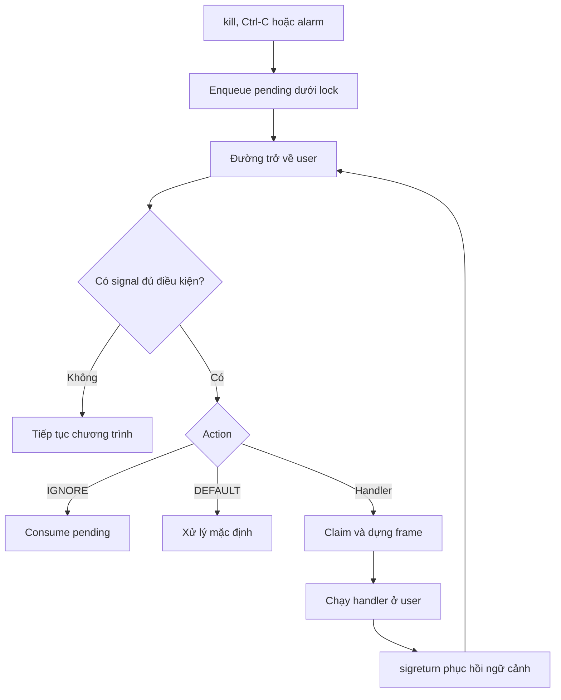

# Signal Delivery

**Người phụ trách:** Phạm Lê Quyền  
**Phạm vi:** Ghi nhận pending, chọn signal và điều phối delivery trong kernel.  
**Trạng thái:** Nghiên cứu và thiết kế; chưa triển khai chức năng signal.

## 1. Kết quả khảo sát mã nguồn

### 1.1. Đường gọi kill hiện tại

Ở bản xv6 được khảo sát, đường gọi là:

`kill(pid)` ở user → stub syscall → `sys_kill()` → `kkill(pid)` trong kernel.

| Vị trí | Nội dung đã kiểm tra |
|---|---|
| `user/user.h:13` | Khai báo hiện tại là `int kill(int)` |
| `user/usys.pl:31` | Sinh stub cho syscall kill |
| `kernel/syscall.h:7` | `SYS_kill` có số hiệu 6 |
| `kernel/sysproc.c:93` | `sys_kill()` lấy một đối số PID rồi gọi `kkill(pid)` |
| `kernel/proc.c:601` | `kkill()` duyệt bảng tiến trình, đặt `killed` dưới `p->lock` |
| `kernel/trap.c:38` | `usertrap()` kiểm tra `killed` và gọi `kexit(-1)` |

`kkill()` từ chối PID bằng 0. Khi tìm thấy PID, hàm đặt `p->killed = 1`; nếu tiến trình đang `SLEEPING` thì chuyển thành `RUNNABLE`, sau đó trả về 0. Hàm không chờ tiến trình thực sự kết thúc. Trong nhánh PID khớp, code hiện tại không kiểm tra riêng trạng thái `ZOMBIE`.

Cơ chế này phù hợp với yêu cầu kết thúc tiến trình, nhưng chưa biểu diễn được signal có handler, signal đang bị chặn hoặc nhiều loại signal cùng chờ. Vì vậy, thiết kế mới cần trạng thái pending riêng. Không thể đặt `killed` cho mọi lần gửi signal, vì tiến trình có thể bị kết thúc trước khi chạy handler.

Khi mở rộng thành `kill(pid, sig)`, đường gọi user và kernel phải dùng cùng chữ ký. Giá trị trả về thành công chỉ xác nhận signal đã được ghi nhận, không có nghĩa handler đã chạy.

### 1.2. Trạng thái tiến trình và đường trở về user

| Vị trí | Nhận xét liên quan đến signal |
|---|---|
| `kernel/proc.h:82` | `struct proc` chứa lock, killed và con trỏ trapframe |
| `kernel/types.h:6` | Baseline đã có kiểu `uint32` |
| `kernel/trap.c:88` | `usertrap()` gọi `prepare_return()` sau bước yield của timer interrupt |
| `kernel/trap.c:101` | `prepare_return()` chuẩn bị trạng thái trở về user; gọi `intr_off()` ở dòng 108 |
| `kernel/proc.c:513` | `forkret()` thả `p->lock` rồi cũng đi qua `prepare_return()` |
| `kernel/syscall.c:146` | Dispatcher ghi giá trị syscall trả về vào `trapframe->a0` |
| `kernel/vm.c:345` | `copyout()` nhận cả kích thước bộ nhớ tiến trình và có đường gọi `vmfault()` |

Nhóm chọn hướng tích hợp delivery ở đầu `prepare_return()`, trước `intr_off()`. Vị trí này bao phủ cả đường usertrap và lần đầu tiến trình con trở về user qua forkret. Khi triển khai vẫn phải kiểm tra trạng thái `killed`, lock và đường lỗi trước khi chuyển về user.

## 2. Thiết kế pending và chọn signal

Pending và mask được lưu chung trong `struct proc`, dùng mask 32 bit. Quy ước là signal nằm trong khoảng `1 <= sig < NSIG <= 32`, bit 0 không dùng. Chỉ dịch bit sau khi kiểm tra số hiệu hợp lệ.

```c
// Minh họa trạng thái dự kiến, chưa phải code đã triển khai.
uint32 pending_signals;
uint32 blocked_signals;
```

- `pending_signals`: signal đã gửi đến nhưng chưa được xử lý.
- `blocked_signals`: signal đang bị chặn.
- `SUPPORTED_MASK`: tập signal dự án hỗ trợ.
- `UNBLOCKABLE_MASK`: tập signal không được chặn nếu nhóm đưa chúng vào phạm vi hỗ trợ.

Cách tính tập signal có thể chọn:

```c
bit = 1U << sig;   // sig đã được kiểm tra hợp lệ
effective_blocked = blocked_signals & ~UNBLOCKABLE_MASK;
ready = pending_signals & SUPPORTED_MASK & ~effective_blocked;
```

Nếu có nhiều bit trong `ready`, chọn signal có số hiệu nhỏ nhất. Đây là thứ tự nhóm lựa chọn để dễ kiểm thử; signal số lớn có thể chờ lâu nếu signal số nhỏ liên tục xuất hiện.

Signal đang bị chặn vẫn được ghi vào pending. Khi bỏ chặn, kernel xét lại ở đường trở về user. Nhiều lần gửi cùng một signal khi bit pending còn bật được gộp thành một lần đang chờ; bitmask không lưu số lần gửi.

## 3. Giao diện giữa các phần

Tên hàm dưới đây là giao diện thiết kế, chưa phải hàm đã có trong baseline.

| Giao diện | Phụ trách | Trách nhiệm |
|---|---|---|
| `signal_send(pid, sig)` | Quyền | Kiểm tra đối số, tìm tiến trình và ghi nhận signal |
| `signal_enqueue_locked(p, sig)` | Quyền | Đặt pending; bên gọi đang giữ `p->lock` |
| `signal_select_locked(p)` | Quyền | Chọn signal đủ điều kiện, chưa xóa pending; trả 0 nếu không có |
| `signal_deliver_current()` | Quyền + Hưng | Điều phối action, claim và setup cho tiến trình hiện tại |
| `signal_setup_handler(p, sig, action, oldmask)` | Hưng | Dựng frame, chuẩn bị ngữ cảnh và báo kết quả |
| Cập nhật mask và mask handler | Kiên + Hưng | Dùng cùng quy ước bit; lưu và khôi phục mask cũ |
| Alarm hết hạn | Kiên + Quyền | Ghi SIGALRM vào pending qua enqueue chung |

## 4. Thuật toán gửi và delivery

### 4.1. Gửi signal

```text
signal_send(pid, sig):
    kiểm tra PID và số hiệu signal
    nếu không hợp lệ: trả -1

    duyệt từng slot trong bảng tiến trình:
        giữ p.lock
        nếu PID khớp và trạng thái cho phép nhận signal:
            đặt bit pending
            nếu là signal buộc kết thúc:
                áp dụng đường đánh thức/killed phù hợp
            thả p.lock
            trả 0
        thả p.lock

    trả -1
```

Phạm vi ban đầu hướng tới PID dương của một tiến trình; chưa mặc định hỗ trợ process group, PID âm hoặc `sig=0`. Cần ghi rõ trạng thái nào được nhận signal, đặc biệt `UNUSED`, `ZOMBIE` và trạng thái chuyển tiếp.

Hàm gửi chỉ ghi nhận yêu cầu. Không sửa trapframe của tiến trình đích tại đây, vì tiến trình đó có thể đang chạy hoặc đang ngủ và chưa ở điểm an toàn để dựng handler.

### 4.2. Chọn và xử lý trước khi trở về user

```text
signal_deliver_current():
    giữ p.lock
    chọn signal trong pending không bị chặn
    nếu không có: thả lock và trở về
    lấy snapshot action và mask cũ

    nếu IGNORE:
        xóa pending tương ứng
        thả lock và trở về

    nếu DEFAULT:
        consume pending theo hành vi mặc định
        thả lock
        thực hiện hành vi đó tại điểm hợp lệ
        trở về nếu hành vi cho phép

    claim signal: xóa bit pending dưới lock
    thả lock
    nhờ module handler chuẩn bị frame và ngữ cảnh
    nếu setup lỗi:
        xử lý kết thúc tại điểm hợp lệ
    nếu thành công:
        công bố trapframe và mask mới
        trở về user để chạy handler
```

Claim trước khi dựng frame giúp tránh mất signal mới. Sau khi thả lock, một lần gửi khác có thể đặt lại cùng bit pending. Nếu setup xong rồi xóa bit thêm lần nữa, lần gửi mới sẽ bị mất. Vì vậy, commit handler không xóa pending lần hai.

Không giữ `p->lock` qua thao tác dựng frame/copyout. Nếu setup thất bại, không trở về user với trapframe đã sửa dở. Thiết kế chung chọn hướng kết thúc tiến trình tại điểm hợp lệ; chi tiết prepare/commit cần được thống nhất trong code với Hưng.

Mỗi lượt trở về user chỉ cài tối đa một handler mới. Action mặc định phải tra theo bảng signal, không coi DEFAULT là IGNORE.

## 5. Phối hợp với Hưng và Kiên

### 5.1. Pending, mask và alarm

Quyền quản lý pending và lựa chọn signal; Kiên quản lý mask và timer. Khi `sigprocmask()` bỏ chặn, syscall chỉ cập nhật mask, còn delivery thực hiện ở đường trở về user. Alarm hết hạn cũng chỉ enqueue SIGALRM, kể cả khi signal này đang bị chặn.

Cập nhật pending/mask và snapshot action tuân thủ `p->lock`. Cấu hình một CPU vẫn cần lock vì ngắt và scheduler có thể xen kẽ. Khi tích hợp timer phải kiểm tra thứ tự `tickslock` và `p->lock`, tránh lấy lock ngược thứ tự.

### 5.2. Handler, mask và nested signals

Mask khi vào handler được tính theo thiết kế tự chặn signal đang xử lý:

```text
handler_mask = (old_mask | action.sa_mask | bit(sig))
               & SUPPORTED_MASK & ~UNBLOCKABLE_MASK
```

Hưng lưu mask cũ và ngữ cảnh user vào frame trên user stack. `sigreturn()` phục hồi frame gần nhất theo LIFO. Signal khác chưa bị chặn có thể tạo handler lồng ở lần delivery tiếp theo. Vì đề bài yêu cầu test nested signals, không thể chỉ dùng một vùng lưu trapframe duy nhất hoặc tắt toàn bộ nesting trong sản phẩm cuối.

Chi tiết bố trí frame và phục hồi thanh ghi thuộc tài liệu handler của Hưng. Phần delivery chỉ cần bảo đảm signal đã claim được chuyển đúng sang module setup và không công bố ngữ cảnh khi setup thất bại.

### 5.3. Delivery khi tiến trình đang ngủ

Giai đoạn đầu, signal thường được giữ pending khi tiến trình ngủ; chưa thiết kế lại mọi syscall thành interruptible syscall. Signal buộc kết thúc dùng đường đánh thức phù hợp đã kiểm chứng. Chỉ đặt tiến trình thành RUNNABLE có thể chưa đủ, vì vòng chờ có thể ngủ lại.

## 6. Sơ đồ luồng



## 7. Kiểm thử cho phần delivery

| Tình huống | Kết quả mong đợi |
|---|---|
| Signal có handler, không blocked | Chọn đúng signal và chuyển cho module setup handler |
| Signal đang blocked | Ghi pending, chưa delivery |
| Bỏ chặn signal đang pending | Delivery ở điểm trở về user tiếp theo |
| Gửi lặp cùng signal khi còn pending | Gộp thành một bit pending |
| Nhiều signal đủ điều kiện | Chọn signal có số hiệu nhỏ nhất |
| PID hoặc signal không hợp lệ | Trả lỗi, không sửa nhầm trạng thái |
| Signal mới đến sau claim, trước commit | Lần gửi mới vẫn còn pending |
| Action IGNORE hoặc DEFAULT | Consume và xử lý đúng bảng hành vi |
| Setup handler thất bại | Không trở về user với ngữ cảnh sửa dở |
| Đang chạy handler, nhận signal khác | Cho phép delivery lồng nếu signal mới không bị chặn |
| Tiến trình đang ngủ nhận signal | Tuân thủ chính sách sleep đã nêu |


