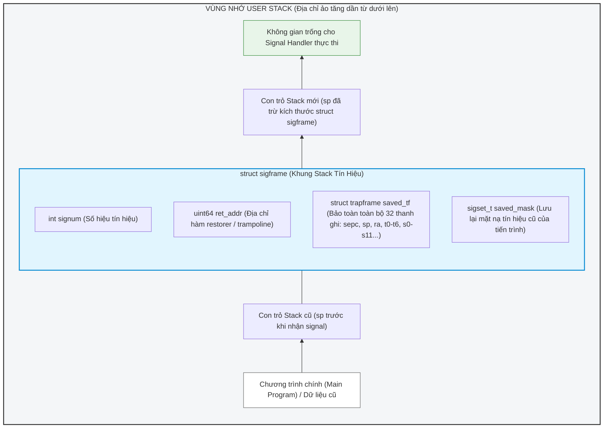

```markdown
# ĐẶC TẢ THIẾT KẾ KỸ THUẬT: SIGNAL HANDLER & CONTEXT RESTORATION
* **Module:** Signal Handler & Context Restoration (Phụ trách: Trần Việt Hưng)
* **Đề tài:** POSIX-style signal (Mã dự án: 26106)

---

## 1. Mục tiêu module
* Xây dựng cơ chế đăng ký trình xử lý tín hiệu thông qua system call `sigaction`.
* Hiện thực hóa việc chuyển hướng luồng thực thi của tiến trình từ không gian người dùng (`user mode`) sang chạy `signal handler` khi có tín hiệu chưa bị chặn.
* Thiết kế khung stack chuyên biệt (`sigframe`) trên `user stack` để lưu trữ toàn bộ ngữ cảnh tiến trình.
* Hiện thực hóa system call `sigreturn` để khôi phục nguyên vẹn trạng thái thanh ghi và tiếp tục chu trình thực thi của chương trình.

## 2. Các file liên quan
* `kernel/trap.c`: Điểm kiểm tra tín hiệu và chuẩn bị trả về `user mode`.
* `kernel/proc.h`: Cấu trúc tiến trình `struct proc` và bảng lưu trạng thái thanh ghi `struct trapframe`.
* `kernel/trampoline.S`: Đoạn mã hợp ngữ xử lý việc lưu/khôi phục toàn bộ thanh ghi giữa `user mode` và `kernel mode`.
* `kernel/syscall.c` & `kernel/syscall.h`: Quản lý bảng lời gọi hệ thống (`sys_sigaction`, `sys_sigreturn`).

---

## 3. Phân tích `trapframe` và Lý do vì sao khôi phục mỗi `PC` (Program Counter) là không đủ?

### a. Phân tích `struct trapframe` (`kernel/proc.h`)
Khi một tiến trình đang chạy ở user mode bị ngắt (do ecall, timer, hay ngoại lệ), phần cứng RISC-V lưu con trỏ lệnh hiện tại vào thanh ghi `sepc` và chuyển quyền điều khiển vào kernel thông qua `trampoline.S`. Đoạn mã hợp ngữ này sẽ cất giữ **toàn bộ 32 thanh ghi phần cứng** của tiến trình vào cấu trúc `struct trapframe`, bao gồm:
* Thanh ghi con trỏ lệnh (`epc` / `sepc`).
* Thanh ghi ngăn xếp (`sp` - x2).
* Các thanh ghi giá trị trả về và tham số (`a0` đến `a7` - x10 đến x17).
* Các thanh ghi lưu trữ tạm thời (`t0` đến `t6`) và các thanh ghi được bảo toàn bởi hàm (`s0` đến `s11`).

### b. Giải thích vì sao khôi phục mỗi Program Counter (`PC` / `epc`) là không đủ?
Nhiều người lầm tưởng rằng khi tín hiệu đến, kernel chỉ cần lưu lại địa chỉ lệnh hiện tại (`PC`), nhảy đi chạy hàm handler, rồi gán lại `PC` cũ để chạy tiếp là xong. **Điều này hoàn toàn sai lầm và sẽ làm hỏng chương trình ngay lập tức vì các lý do sau:**
1. **Xung đột giá trị thanh ghi (Register Clobbering):** Hàm `signal handler` là một hàm viết bằng C do người dùng định nghĩa. Khi hàm này chạy, nó sẽ tùy ý sử dụng các thanh ghi chung (như `t0-t6`, `a0-a7`, `s0-s11`) để tính toán. Nếu kernel không lưu lại trạng thái các thanh ghi này trước khi gọi handler, toàn bộ dữ liệu đang tính toán dở dang trong các thanh ghi của chương trình chính sẽ bị **ghi đè và xóa sạch vĩnh viễn**.
2. **Hỏng con trỏ ngăn xếp (`Stack Pointer - SP`):** Hàm handler cần không gian trên stack để cấp phát biến cục bộ và gọi hàm con. Nếu không chuyển hướng hoặc lưu trữ `sp`, handler có thể ghi đè lên dữ liệu của chương trình chính.
3. **Trạng thái hàm bị gián đoạn:** Một tiến trình không chỉ đơn thuần là `PC`. Nó là tập hợp của toàn bộ ngữ cảnh phần cứng tại thời điểm bị ngắt. Do đó, **bắt buộc phải bảo toàn toàn bộ 32 thanh ghi** thông qua một khung stack chuyên biệt (`sigframe`) chứ không thể chỉ lưu mỗi `PC`.

---

## 4. Thiết kế lưu Handler và Signal Action
Trong cấu trúc quản lý tiến trình `struct proc`, ta bổ sung mảng quản lý hành động:
```c
struct sigaction sig_actions[MAXSIG];

```

Với cấu trúc `struct sigaction`:

```c
struct sigaction {
  void (*sa_handler)(int);     // Địa chỉ hàm xử lý tín hiệu ở user space
  sigset_t sa_mask;            // Các tín hiệu bị chặn bổ sung khi handler đang chạy
  int sa_flags;                // Cờ cấu hình (ví dụ: SA_RESTART)
  void (*sa_restorer)(void);   // Con trỏ tới hàm gọi sigreturn sau khi handler kết thúc
};

```

---

## 5. Sơ đồ Handler Frame trên User Stack (`sigframe`)

Ngay trước khi kernel trả quyền về user mode để chạy handler, kernel sẽ cấp phát và đẩy cấu trúc `sigframe` lên đỉnh của **User Stack**:



---

## 6. Pseudocode cho `sigreturn()`

Khi hàm handler ở user space thực thi xong, nó sẽ nhảy đến đoạn mã `sa_restorer` (hoặc trampoline phía user), từ đó gọi lời gọi hệ thống `sys_sigreturn()`. Thuật toán thực hiện trong kernel:

```c
uint64 sys_sigreturn(void) {
    struct proc *p = myproc();
    
    // 1. Tính toán vị trí sigframe hiện tại trên user stack của tiến trình
    uint64 frame_addr = p->trapframe->sp; 
    
    // 2. Đọc cấu trúc sigframe từ user stack xuống kernel qua copyin
    struct sigframe sf;
    if (copyin(p->pagetable, (char*)&sf, frame_addr, sizeof(sf)) < 0)
        return -1;
        
    // 3. Khôi phục lại toàn bộ trạng thái thanh ghi ban đầu vào trapframe của tiến trình
    *(p->trapframe) = sf.saved_tf;
    
    // 4. Phục hồi lại mặt nạ tín hiệu cũ của tiến trình
    p->sig_blocked = sf.saved_mask;
    
    // 5. Trả về giá trị trong saved_tf (thường là a0 của luồng chính trước khi bị ngắt)
    return p->trapframe->a0;
}

```

---

## 7. Phương án xử lý `Nested Handlers` (Tín hiệu lồng nhau)

* **Vấn đề:** Trong lúc hàm handler thứ nhất đang chạy, nếu một tín hiệu khác (được phép) gửi đến, tiến trình có thể bị ngắt lần nữa. Nếu không quản lý tốt, các `sigframe` trên user stack có thể chồng đè lên nhau gây hỏng dữ liệu.
* **Phương án giải quyết (Cơ chế LIFO):**
* Mỗi lần có tín hiệu mới xen ngang, kernel sẽ tiếp tục hạ con trỏ `sp` xuống thêm một đoạn bằng kích thước `sizeof(struct sigframe)` để dựng tầng frame mới ngay bên dưới tầng cũ (hoạt động theo nguyên tắc **LIFO - Vào sau ra trước**).
* `sa_mask` của từng handler sẽ được áp dụng để tự động chặn các tín hiệu tương ứng, tránh việc một loại tín hiệu bị lặp vô tận làm tràn stack.
* Khi từng handler kết thúc, các lệnh `sigreturn` sẽ lần lượt tháo gỡ các tầng frame theo đúng thứ tự LIFO, phục hồi hoàn hảo từng lớp ngữ cảnh trước đó.


```

```
