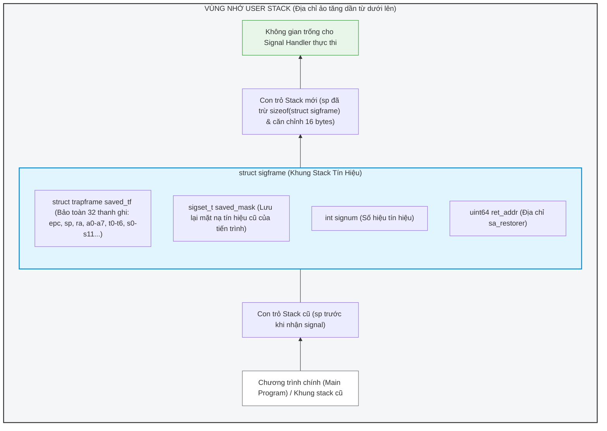

# ĐẶC TẢ THIẾT KẾ KỸ THUẬT: SIGNAL HANDLER & CONTEXT RESTORATION
* **Module:** Signal Handler & Context Restoration (Phụ trách: Trần Việt Hưng)
* **Đề tài:** POSIX-style signal (Mã dự án: 26106)
* **Trạng thái:** Đã chuẩn hóa thiết kế, đồng bộ cùng module Delivery (Quyền) và Mask/Alarm (Kiên).

---

## 1. Mục tiêu module
* Xây dựng cơ chế đăng ký và cấu hình hành vi tín hiệu thông qua system call `sigaction`.
* Hiện thực hóa chuyển hướng luồng thực thi từ user mode sang chạy `signal handler` khi có tín hiệu đủ điều kiện delivery.
* Thiết kế khung stack chuyên biệt (`sigframe`) trên `user stack` theo chuẩn RISC-V ABI (16-byte alignment, tham số qua thanh ghi `a0`, địa chỉ trở về qua `ra`).
* Hiện thực hóa system call `sigreturn` để khôi phục nguyên vẹn 100% ngữ cảnh thanh ghi và signal mask của tiến trình.
* Hỗ trợ cơ chế Nested Handlers (tín hiệu lồng nhau) hoạt động theo nguyên tắc LIFO.

---

## 2. Các file liên quan & Tương tác Kernel
* `kernel/signal.h`: Định nghĩa các hằng số tín hiệu, `NSIG`, `sigset_t`, `struct sigaction`, `struct sigframe`.
* `kernel/proc.h`: Mở rộng `struct proc` chứa bảng action và các trường signal mask/pending.
* `kernel/trap.c`: Điểm gọi `sig_setup_frame()` trong `prepare_return()` trước khi quay về user mode.
* `kernel/syscall.c` & `kernel/syscall.h`: Khai báo và dispatch `SYS_sigaction` (23), `SYS_sigreturn` (24); xử lý ngoại lệ không ghi đè `a0` khi `sigreturn`.
* `kernel/sysproc.c`: Hiện thực hàm `sys_sigaction()` và `sys_sigreturn()`.
* `user/user.h` & `user/usys.pl`: Khai báo wrapper và system call stubs phía user space.

---

## 3. Phân tích Trapframe và Yêu cầu khôi phục ngữ cảnh trên RISC-V

### a. Cấu trúc `struct trapframe` (`kernel/proc.h`)
Khi tiến trình user bị ngắt (do trap, interrupt hoặc syscall), mã hợp ngữ `trampoline.S` lưu toàn bộ trạng thái phần cứng vào `struct trapframe`, bao gồm:
* `epc`: Program Counter tại thời điểm bị ngắt.
* `sp`: Stack Pointer (x2) của user space.
* `ra`: Return Address (x1).
* `a0 - a7`: Thanh ghi tham số và giá trị trả về (x10 - x17).
* `t0 - t6`: Thanh ghi tạm thời (temporary registers).
* `s0 - s11`: Thanh ghi được bảo toàn bởi hàm (callee-saved registers).

### b. Vì sao chỉ khôi phục Program Counter (`epc`) là KHÔNG ĐỦ?
1. **Xung đột giá trị thanh ghi (Register Clobbering):** Hàm `signal handler` là hàm C bình thường. Khi chạy, compiler sẽ phát sinh mã sử dụng các thanh ghi tính toán (`t0-t6`, `a0-a7`,...). Nếu không sao lưu toàn bộ trapframe trước khi chuyển sang handler, toàn bộ dữ liệu đang tính dở của chương trình chính sẽ bị ghi đè và hỏng dữ liệu ngay lập tức.
2. **Nguy cơ hỏng User Stack:** Handler cần stack để cấp phát biến cục bộ và gọi hàm con. Nếu không hạ `sp` để cấp phát khung `sigframe`, handler sẽ ghi đè lên các khung hàm đang hoạt động của chương trình chính.
3. **Phục hồi nguyên vẹn trạng thái gián đoạn:** Để chương trình chính tiếp tục chạy thông suốt sau khi handler kết thúc, toàn bộ 32 thanh ghi phần cứng cùng mặt nạ tín hiệu (`sigset_t`) trước thời điểm nhận tín hiệu phải được khôi phục nguyên vẹn.

---

## 4. Cấu trúc Dữ liệu & Hằng số dùng chung 

Thống nhất sử dụng chung các định nghĩa trong `kernel/signal.h`:

```c
#define NSIG 32               // Hỗ trợ tối đa 32 signals (tương ứng bitmask 32-bit)

typedef uint32 sigset_t;      // Mặt nạ tín hiệu 32-bit (bit 1..31, bit 0 không dùng)

#define SIG_DFL ((void (*)(int))0)   // Xử lý mặc định
#define SIG_IGN ((void (*)(int))1)   // Bỏ qua tín hiệu

struct sigaction {
  void (*sa_handler)(int);     // Con trỏ hàm xử lý tín hiệu, SIG_DFL hoặc SIG_IGN
  sigset_t sa_mask;            // Các tín hiệu bị chặn bổ sung khi handler này chạy
  int sa_flags;                // Cờ cấu hình bổ sung (mặc định 0)
  void (*sa_restorer)(void);   // Con trỏ tới hàm gọi sigreturn sau khi handler kết thúc
};
```

Trong `struct proc` (`kernel/proc.h`), bổ sung các trường đồng bộ:
```c
// Được bảo vệ bởi p->lock
sigset_t pending_signals;            // Tín hiệu đang chờ (Quyền quản lý)
sigset_t blocked_signals;            // Tín hiệu bị chặn (Kiên quản lý)
struct sigaction sig_actions[NSIG];  // Bảng cấu hình hành vi của từng signal (Hưng quản lý)
```

---

## 5. Thiết kế Khung Stack Tín Hiệu (`struct sigframe`) & RISC-V Calling Convention

### a. Cấu trúc `struct sigframe`
Khung stack tín hiệu được kernel ghi vào vùng nhớ user stack của tiến trình:

```c
struct sigframe {
  struct trapframe saved_tf;   // Toàn bộ ngữ cảnh trapframe trước khi nhận signal
  sigset_t saved_mask;         // Mặt nạ tín hiệu cũ của tiến trình
  int signum;                  // Số hiệu tín hiệu được xử lý
  uint64 ret_addr;             // Địa chỉ trở về (sa_restorer)
};
```

### b. Sơ đồ User Stack khi kích hoạt Handler



### c. Quy tắc thiết lập thanh ghi phần cứng theo chuẩn RISC-V ABI
Khi thiết lập chạy handler, kernel chuẩn bị các thanh ghi trong `p->trapframe` như sau:
1. **Tham số hàm (`a0`):** Handler nhận đối số là số hiệu signal (`void handler(int sig)`). Do đó, kernel gán:
   `p->trapframe->a0 = signum;`
2. **Con trỏ lệnh (`epc`):** Đặt điểm nhảy vào mã nguồn của handler:
   `p->trapframe->epc = (uint64)act->sa_handler;`
3. **Thanh ghi liên kết (`ra`):** Khi hàm handler thực hiện lệnh `ret`, CPU sẽ nhảy đến địa chỉ trong `ra`. Kernel gán:
   `p->trapframe->ra = (uint64)act->sa_restorer;`
   *(Tại `sa_restorer`, chương trình user sẽ thực hiện ecall gọi `sigreturn()`)*.
4. **Căn chỉnh Stack Pointer (`sp`):** Chuẩn RISC-V bắt buộc con trỏ stack phải căn chỉnh 16-byte:
   `new_sp = (p->trapframe->sp - sizeof(struct sigframe)) & ~0xF;`
   `p->trapframe->sp = new_sp;`

---

## 6. Giao tiếp giữa Delivery (Quyền) và Handler (Hưng)

Trước khi quay lại user mode trong `prepare_return()`, module Delivery của Quyền chọn được signal hợp lệ sẽ gọi sang hàm dựng frame của Hưng:

```c
// Trả về 0 nếu thành công, -1 nếu thất bại (lỗi bộ nhớ, copyout thất bại)
int sig_setup_frame(int sig, struct sigaction *act) {
    struct proc *p = myproc();
    struct sigframe sf;
    
    // 1. Tính toán địa chỉ stack mới và căn chỉnh 16-byte
    uint64 new_sp = (p->trapframe->sp - sizeof(struct sigframe)) & ~0xF;
    
    // Kiểm tra giới hạn bộ nhớ user stack hợp lệ
    if (new_sp >= p->sz || new_sp < p->trapframe->sp - PGSIZE)
        return -1;
        
    // 2. Sao lưu ngữ cảnh cũ vào sigframe
    sf.saved_tf = *(p->trapframe);
    sf.saved_mask = p->blocked_signals;
    sf.signum = sig;
    sf.ret_addr = (uint64)act->sa_restorer;
    
    // 3. Đẩy sigframe lên user stack
    if (copyout(p->pagetable, new_sp, (char*)&sf, sizeof(sf)) < 0)
        return -1;
        
    // 4. Áp dụng mặt nạ tín hiệu mới khi vào handler (khớp thiết kế của Quyền & Kiên):
    // Tự động chặn chính signal đang xử lý và các signal trong sa_mask
    p->blocked_signals |= (act->sa_mask | (1U << sig));
    p->blocked_signals &= ~UNBLOCKABLE_MASK; // Không được chặn SIGKILL
    
    // 5. Cập nhật trapframe để chuyển sang chạy handler
    p->trapframe->sp = new_sp;
    p->trapframe->epc = (uint64)act->sa_handler;
    p->trapframe->ra = (uint64)act->sa_restorer;
    p->trapframe->a0 = sig;
    
    return 0;
}
```

---

## 7. Hiện thực `sys_sigreturn()` & Xử lý bảo toàn thanh ghi `a0`

### a. Pseudocode cho `sys_sigreturn()`
Khi handler chạy xong và gọi `sigreturn()`, kernel tháo gỡ frame và phục hồi ngữ cảnh:

```c
uint64 sys_sigreturn(void) {
    struct proc *p = myproc();
    struct sigframe sf;
    uint64 frame_addr = p->trapframe->sp;
    
    // 1. Đọc sigframe từ user stack vào kernel
    if (copyin(p->pagetable, (char*)&sf, frame_addr, sizeof(sf)) < 0)
        return -1;
        
    // 2. Phục hồi nguyên vẹn 100% trapframe cũ
    *(p->trapframe) = sf.saved_tf;
    
    // 3. Khôi phục lại signal mask cũ của tiến trình
    p->blocked_signals = sf.saved_mask;
    
    // 4. Trả về giá trị a0 cũ đã được khôi phục
    return p->trapframe->a0;
}
```

### b. Xử lý nguy cơ ghi đè `a0` trong Dispatcher của xv6
* **Vấn đề:** Trong `kernel/syscall.c`, dispatcher của xv6 mặc định luôn gán:
  `p->trapframe->a0 = syscalls[num]();`
  Lệnh này sẽ ghi đè giá trị trả về của `sys_sigreturn()` vào `trapframe->a0`, làm sai lệch giá trị thanh ghi `a0` ban đầu của chương trình chính nếu không được xử lý cẩn thận.
* **Giải pháp thống nhất với cả nhóm:**
  Trong `syscall()` (`kernel/syscall.c`), bổ sung điều kiện loại trừ cho `SYS_sigreturn`:
  ```c
  if (num == SYS_sigreturn) {
      sys_sigreturn(); // Không gán lại p->trapframe->a0 để giữ trọn vẹn ngữ cảnh khôi phục
  } else {
      p->trapframe->a0 = syscalls[num]();
  }
  ```

---

## 8. Phương án xử lý `Nested Handlers` (Tín hiệu lồng nhau)

* **Cơ chế LIFO (Last-In, First-Out):**
  * Khi đang thực thi một handler, nếu có một tín hiệu khác đến (và tín hiệu này không nằm trong `blocked_signals`), kernel tiếp tục hạ `sp` xuống thêm `sizeof(struct sigframe)` và dựng một tầng `sigframe` mới nằm đè dưới tầng cũ.
  * Mỗi tầng `sigframe` lưu trữ chính xác `saved_tf` và `saved_mask` của thời điểm ngay trước khi nó bị ngắt.
  * Khi các lệnh `sigreturn()` được gọi liên tiếp, kernel sẽ giải phóng các tầng frame theo đúng thứ tự LIFO, phục hồi từng lớp ngữ cảnh cho đến khi quay về luồng thực thi của chương trình chính.
* **Ngăn ngừa tràn stack do tín hiệu lặp lại:**
  * Nhờ cơ chế `p->blocked_signals |= (act->sa_mask | (1U << sig))`, tín hiệu cùng loại sẽ tự động bị chặn trong thời gian handler đang xử lý, ngăn chặn việc kích hoạt handler đệ quy vô tận làm tràn user stack.
