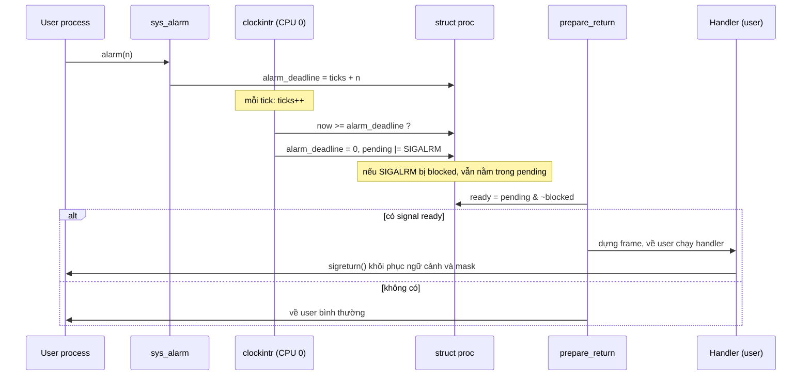

# Signal Mask và Alarm

**Người phụ trách:** Nguyễn Trung Kiên  
**Phạm vi:** `sigprocmask()`, `alarm()` và timer tick.  
**Trạng thái:** Nghiên cứu và thiết kế; chưa triển khai, chưa build, chưa chạy test.

## 1. Mục tiêu module

- Cho process chặn (block) và bỏ chặn (unblock) signal bằng `sigprocmask()`.
- Signal bị chặn vẫn được ghi vào pending; khi bỏ chặn thì được delivery ở điểm trở về user tiếp theo.
- Cho process đặt hẹn giờ bằng `alarm()`; khi hết hạn kernel đặt SIGALRM vào pending.
- Timer interrupt chỉ cập nhật trạng thái tối thiểu, không chạy handler user.

Ngoài phạm vi: process group, `sigpending()`, `sigsuspend()`, alarm theo đơn vị thời gian thực (giây/ms), restart syscall.

## 2. Khảo sát mã nguồn xv6

Baseline đã khảo sát: commit `19959d4` của repo nhóm (xv6-riscv bản mới, dùng `kkill`, `kexit`, `sleep_prepare`/`sleep`).

| Vị trí | Nhận xét liên quan |
|---|---|
| `kernel/proc.h:82` | `struct proc` chưa có trường signal nào. Chỉ có `killed` (dòng 88), được bảo vệ bởi `p->lock` |
| `kernel/proc.c:110` | `allocproc()` khởi tạo state; cần thêm khởi tạo mask/alarm |
| `kernel/proc.c:156` | `freeproc()` reset `killed`; cần reset thêm mask/pending/alarm |
| `kernel/proc.c:259` | `kfork()` chưa copy trạng thái signal; cần quyết định con có thừa kế mask không |
| `kernel/proc.c:601` | `kkill(pid)` chỉ đặt `killed = 1`, chưa có số hiệu signal |
| `kernel/trap.c:38` | `usertrap()` xử lý syscall, interrupt, fault |
| `kernel/trap.c:85` | Timer interrupt (`which_dev == 2`) chỉ gọi `yield()` |
| `kernel/trap.c:101` | `prepare_return()` là điểm cuối cùng trước khi về user; nhóm chọn delivery ở đây |
| `kernel/trap.c:167` | `clockintr()`: chỉ CPU 0 tăng `ticks` dưới `tickslock` và gọi `wakeup(&ticks)` |
| `kernel/sysproc.c:68` | `sys_pause()` là ví dụ đọc `ticks` dưới `tickslock` |
| `kernel/syscall.h:23` | Syscall cuối là `SYS_sync` = 22; số mới bắt đầu từ 23 (cần thống nhất để khỏi trùng) |
| `kernel/console.c` | Chưa có xử lý Ctrl+C thành signal; đó là phần tích hợp của nhóm |

Ta có:

1. **`ticks` chỉ tăng ở CPU 0** (`trap.c:171`). Nhưng mọi CPU đều nhận timer interrupt. Vì vậy nếu mỗi process tự đếm lùi trong `usertrap()` mỗi khi `which_dev == 2`, tốc độ đếm phụ thuộc số CPU và process nào đang chạy. Thiết kế dùng `ticks` toàn cục sẽ nhất quán hơn (xem mục 5).
2. **Timer interrupt đã có sẵn đường gọi `wakeup()` từ `clockintr()`**, trong đó `wakeup()` lấy `p->lock` của từng process. Nghĩa là thứ tự khóa `tickslock` → `p->lock` đã tồn tại và an toàn; alarm có thể dùng đúng thứ tự này.

## 3. Phân tích signal mask

### 3.1. Khái niệm

- **Signal mask** (`blocked_signals`) là tập signal mà process đang chặn. Mỗi bit ứng với một signal.
- **Pending** (`pending_signals`) là tập signal đã được gửi đến nhưng chưa được xử lý.
- **Blocked khác pending:** blocked là *chính sách* của process ("chưa muốn nhận signal này"); pending là *sự kiện* ("signal này đã đến"). Signal bị chặn vẫn được ghi vào pending, chỉ không được chọn để delivery.
- Signal đủ điều kiện delivery: `ready = pending & SUPPORTED_MASK & ~effective_blocked` (theo `docs/signal-delivery.md`).

### 3.2. Biểu diễn (đề xuất, cần Quyền xác nhận)

```c
// trong struct proc, bảo vệ bởi p->lock
uint32 pending_signals;
uint32 blocked_signals;
```

- Signal hợp lệ: `1 <= sig < NSIG`, `NSIG <= 32`; bit 0 không dùng.
- Bit của signal `sig` là `1U << sig`, chỉ tính sau khi đã kiểm tra `sig` hợp lệ.
- `SIGKILL` (nếu nhóm đưa vào phạm vi) nằm trong `UNBLOCKABLE_MASK`, không thể chặn.

### 3.3. Khi unblock thì signal được xử lý thế nào

`sigprocmask()` chỉ cập nhật `blocked_signals`. Nó **không** gọi handler. Lần tới process đi qua `prepare_return()`, kernel tính lại `pending & ~blocked`; nếu có bit thì delivery như bình thường. Nhờ vậy:

- Không chạy handler user trong ngữ cảnh syscall.
- Signal đến trong lúc bị chặn không bị mất (bit pending được giữ).
- Signal gửi nhiều lần khi đang chặn gộp thành một lần.

Lưu ý: syscall `sigprocmask()` quay về user qua `usertrap()` → `prepare_return()`, nên signal vừa được bỏ chặn sẽ được delivery ngay khi syscall này trả về, trước lệnh kế tiếp của chương trình.

## 4. Thuật toán block/unblock

### 4.1. Giao diện đề xuất

```c
#define SIG_BLOCK    0   // blocked |= set
#define SIG_UNBLOCK  1   // blocked &= ~set
#define SIG_SETMASK  2   // blocked  = set

int sigprocmask(int how, uint32 set, uint32 *oldset);
```

- `oldset` có thể là con trỏ NULL (0) nếu không cần giá trị cũ.
- Trả 0 nếu thành công, -1 nếu `how` không hợp lệ hoặc `copyout` lỗi.
- `set` được lọc: `set &= SUPPORTED_MASK & ~UNBLOCKABLE_MASK` (bit không hỗ trợ bị bỏ qua, không báo lỗi).

> Cần thống nhất với Quyền/Hưng: truyền `set` theo giá trị hay theo con trỏ; kiểu `uint32` hay `uint64`.

### 4.2. Pseudocode

```text
sys_sigprocmask():
    lấy how, set, oldset_addr từ đối số
    nếu how không thuộc {BLOCK, UNBLOCK, SETMASK}: trả -1

    p = myproc()
    giữ p->lock
    old = p->blocked_signals
    set = set & SUPPORTED_MASK & ~UNBLOCKABLE_MASK
    nếu how == BLOCK:    p->blocked_signals = old | set
    nếu how == UNBLOCK:  p->blocked_signals = old & ~set
    nếu how == SETMASK:  p->blocked_signals = set
    thả p->lock

    nếu oldset_addr != 0:
        nếu copyout(p->pagetable, oldset_addr, &old, sizeof(old)) < 0:
            trả -1        // mask đã đổi; cần thống nhất hành vi này
    trả 0
```

> Điểm cần cân nhắc: nếu `copyout` lỗi sau khi đã đổi mask thì mask vẫn thay đổi. Cách đơn giản: kiểm tra/ghi `oldset` **trước**, hoặc ghi chú rõ hành vi này trong tài liệu và test.

## 5. Thiết kế alarm dựa trên timer tick

### 5.1. Quyết định chính

| Vấn đề | Đề xuất | Lý do |
|---|---|---|
| Đơn vị | tick của `ticks` (xấp xỉ 0,1 giây trên QEMU, theo comment `trap.c:177`) | Nhất quán với `pause()`/`uptime()` |
| Kiểu | one-shot | `AGENTS.md` không cho coi alarm là periodic mặc định; demo periodic tự re-arm trong handler |
| Alarm mới thay alarm cũ | Có; trả về số tick còn lại của alarm cũ | Giống `alarm(2)` của POSIX |
| `alarm(0)` | Hủy alarm, trả số tick còn lại | |
| Lưu trạng thái | `uint64 alarm_deadline` (tick tuyệt đối) | Không cần cập nhật mỗi tick; so sánh bằng phép trừ để an toàn khi tràn |
| Chạy handler | Không; chỉ đặt SIGALRM pending | Handler chạy ở `prepare_return()` |

### 5.2. Trạng thái cần lưu

```c
// trong struct proc, bảo vệ bởi p->lock
uint64 alarm_deadline;   // giá trị ticks khi hết hạn; 0 = không có alarm
```

`alarm()` cần lưu **deadline** (không phải số tick còn lại) vì hai lý do: process có thể ngủ hoặc không được lên lịch trong thời gian chờ, nhưng alarm vẫn phải hết hạn đúng lúc; và kernel không phải cập nhật mỗi tick cho mọi process.

### 5.3. Khi timer hết hạn

Trong `clockintr()` (chỉ CPU 0, sau khi tăng `ticks` và nhả `tickslock`):

```text
alarm_check(now):
    duyệt từng slot p trong bảng tiến trình:
        giữ p->lock
        nếu p->state != UNUSED && p->state != ZOMBIE
           && p->alarm_deadline != 0
           && (int64)(now - p->alarm_deadline) >= 0:
            p->alarm_deadline = 0                  // one-shot
            signal_enqueue_locked(p, SIGALRM)      // hàm của Quyền
        thả p->lock
```

- Hàm chỉ đặt bit pending, không sửa trapframe và không chạy handler.
- SIGALRM vẫn được ghi pending dù đang bị chặn; delivery chờ đến khi bỏ chặn.
- Duyệt cả bảng mỗi tick (NPROC = 64) là chấp nhận được ở quy mô xv6; nếu muốn tối ưu có thể lưu deadline nhỏ nhất, nhưng chưa cần.

> Thứ tự khóa: `clockintr()` không giữ `tickslock` khi gọi `alarm_check()`, và bản thân `wakeup()` đã lấy `p->lock` trong lúc giữ `tickslock`, nên không có đường lấy ngược thứ tự. Khi triển khai vẫn cần xác nhận lại bằng cách đọc code.

### 5.4. `sys_alarm()`

```text
sys_alarm(n):
    lấy n (tick) từ đối số; nếu n < 0: trả -1
    p = myproc()
    now = đọc ticks dưới tickslock (nhả trước khi lấy p->lock)
    giữ p->lock
    còn_lại = (p->alarm_deadline == 0) ? 0 : max(0, p->alarm_deadline - now)
    p->alarm_deadline = (n == 0) ? 0 : now + n
    thả p->lock
    trả còn_lại
```

Đọc `ticks` và lấy `p->lock` tách nhau (không lồng) để tránh tạo thứ tự khóa mới.

### 5.5. Vòng đời process

| Sự kiện | Hành vi đề xuất |
|---|---|
| `allocproc()` | `blocked_signals = 0`, `pending_signals = 0`, `alarm_deadline = 0` |
| `kfork()` | Con thừa kế `blocked_signals` của cha (giống POSIX); **không** thừa kế pending và alarm |
| `exec()` | Giữ mask; alarm bị hủy (đề xuất); cần thống nhất |
| `kexit()` / `freeproc()` | Đặt `alarm_deadline = 0`, xóa pending/blocked |
| Alarm hết hạn khi process là ZOMBIE | Bỏ qua (điều kiện trạng thái ở 5.3) |

## 6. Bảng test cases (kế hoạch, chưa chạy)

> Tất cả các dòng dưới đây là **kế hoạch kiểm thử**. Trạng thái đều là "chưa chạy"; chỉ ghi PASS/FAIL sau khi đã triển khai và chạy thật (đính kèm lệnh và log).

| # | Tình huống | Setup | Action | Expected | Trạng thái |
|---|---|---|---|---|---|
| T1 | Block và pending | Đăng ký handler SIGUSR1; block SIGUSR1 | Tự `kill(getpid(), SIGUSR1)` | Handler chưa chạy; signal ở pending | Chưa chạy |
| T2 | Unblock → delivery | Tiếp T1 | `sigprocmask(SIG_UNBLOCK, SIGUSR1)` | Handler chạy đúng 1 lần ngay sau khi syscall trả về | Chưa chạy |
| T3 | Gộp signal lặp | Block SIGUSR1 | Gửi SIGUSR1 3 lần, rồi unblock | Handler chạy đúng 1 lần | Chưa chạy |
| T4 | `oldset` và `how` sai | Mask đã biết | Gọi với `how=99`; gọi `SETMASK` với `oldset` hợp lệ | `how=99` trả -1 và mask không đổi; `oldset` trả mask cũ | Chưa chạy |
| T5 | Alarm one-shot | Handler SIGALRM tăng biến đếm | `alarm(5)` rồi chờ | Handler chạy 1 lần sau khoảng 5 tick; không chạy lần 2 | Chưa chạy |
| T6 | Alarm re-arm (periodic) | Handler gọi `alarm(5)` lại | Chờ khoảng 30 tick | Handler chạy nhiều lần, khoảng cách xấp xỉ 5 tick | Chưa chạy |
| T7 | Thay và hủy alarm | `alarm(50)` | `alarm(5)` rồi `alarm(0)` | Lần 2 trả số tick còn lại của alarm cũ; sau `alarm(0)` không có signal | Chưa chạy |
| T8 | Alarm + mask | Block SIGALRM | `alarm(3)`, chờ hết hạn, rồi unblock | SIGALRM giữ pending khi bị chặn; handler chạy sau unblock | Chưa chạy |
| T9 | Alarm khi đang ngủ | Process gọi `pause()` dài | `alarm(3)` trước đó | Signal được ghi pending đúng hạn (delivery theo chính sách sleep đã chốt) | Chưa chạy |
| T10 | Exit và fork | Process có alarm đang chạy | Process exit; hoặc `fork()` | Không panic, không alarm "mồ côi"; con không có alarm của cha | Chưa chạy |
| T11 | Đa CPU | Chạy T5, T6 | `CPUS=1` và `CPUS=4` | Kết quả như nhau (không nhân tốc độ theo số CPU) | Chưa chạy |

## 7. Vấn đề cần thống nhất với Quyền và Hưng

**Với Quyền (pending, chọn signal, delivery):**

1. Tên và kiểu trường: `pending_signals`, `blocked_signals` (`uint32`), cùng `SUPPORTED_MASK`, `UNBLOCKABLE_MASK` — ai định nghĩa và ở file nào?
2. `signal_enqueue_locked(p, SIGALRM)` có đặt thêm `killed`/wakeup khi process đang ngủ không? (Đề xuất: SIGALRM chỉ pending, không đánh thức.)
3. Số hiệu signal: SIGALRM, SIGUSR1, SIGINT... nhóm chốt giá trị nào, và `kill` mang chữ ký `kill(pid, sig)` như thế nào (đổi chữ ký `kill` ảnh hưởng `user/kill.c`, `user.h`, `usys.pl`).
4. Điểm delivery ở đầu `prepare_return()` (trước `intr_off()`): `sigprocmask()` có cần gọi gì thêm không, hay chỉ đổi mask?
5. Thứ tự khóa khi `clockintr()` gọi enqueue.

**Với Hưng (handler, frame, sigreturn):**

1. Mask khi vào handler: `handler_mask = old_mask | sa_mask | bit(sig)`; `sigreturn()` khôi phục đúng `old_mask` đã lưu trong frame.
2. `sigreturn()` ghi mask trực tiếp hay gọi chung hàm với `sigprocmask()` (nên có một hàm nội bộ duy nhất để áp dụng bộ lọc `SUPPORTED_MASK` và `UNBLOCKABLE_MASK`)?
3. Alarm re-arm trong handler: `alarm()` gọi từ handler phải hoạt động bình thường (không phụ thuộc vào việc mask đang bị chặn SIGALRM).
4. Nested handler: SIGALRM đến khi đang chạy handler của signal khác.

**Syscall chung:** số syscall mới (`sigaction`, `sigreturn`, `sigprocmask`, `alarm`) — thống nhất thứ tự để ba PR không xung đột trong `kernel/syscall.h`, `kernel/syscall.c`, `user/usys.pl`, `user/user.h`.

## 8. Sơ đồ alarm → pending → delivery



