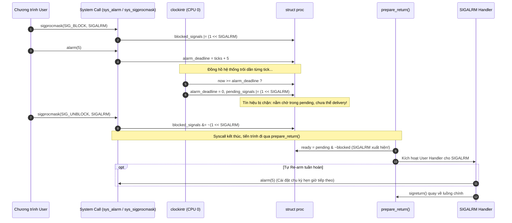

# Đặc tả Thiết kế Kỹ thuật: Signal Masking & Timer Alarm

* **Thành viên phụ trách:** Nguyễn Trung Kiên  
* **Đề tài:** POSIX-style signals trên xv6-riscv (Mã đề tài: 26106)  
* **Vai trò module:** Quản lý mặt nạ tín hiệu (`sigprocmask`), cơ chế hẹn giờ tín hiệu bất đồng bộ (`alarm`), tích hợp quét timer interrupt trong kernel, và chuẩn hóa bảo vệ hệ thống (`sig_sanitize`).

---

## 1. Bản chất Kỹ thuật: Masking và Sự khác biệt giữa Blocked và Pending

Trong mô hình tín hiệu POSIX, hai khái niệm **Blocked (Bị chặn)** và **Pending (Đang chờ)** có ý nghĩa hoàn toàn khác nhau về mặt kiến trúc:

| Khái niệm | Ý nghĩa kiến trúc | Nơi lưu trữ | Bản chất điều khiển |
|---|---|---|---|
| **`pending_signals`** | **Sự kiện thực tế:** Tín hiệu đã được gửi tới tiến trình nhưng chưa được xử lý. | Bitmask 32-bit trong `struct proc` (bảo vệ bởi `p->lock`). | Do bên ngoài hoặc phần cứng kích hoạt (bất đồng bộ). |
| **`blocked_signals`** | **Chính sách của tiến trình:** Danh sách các tín hiệu mà tiến trình tạm thời chưa muốn tiếp nhận tại thời điểm hiện tại. | Bitmask 32-bit trong `struct proc` (dữ liệu private của tiến trình). | Do chính bản thân tiến trình chủ động thiết lập qua `sigprocmask()`. |

### Nguyên tắc Vàng của Signal Masking:
> **Tín hiệu bị chặn (Blocked) KHÔNG bị biến mất, mà vẫn được ghi nhận vào `pending_signals`.**

Khi một tín hiệu đang nằm trong `blocked_signals` được gửi tới:
1. Kernel vẫn bật bit tương ứng trong `p->pending_signals`.
2. Nhưng khi tiến trình đi qua `prepare_return()`, kernel lọc theo công thức:
   $$\text{ready} = \text{pending\_signals} \ \& \ \text{SUPPORTED\_MASK} \ \& \ \sim\text{blocked\_signals}$$
   Vì tín hiệu đang bị block, bit đó không xuất hiện trong `ready`, do đó handler **tạm thời chưa được kích hoạt**.
3. Khi tiến trình gọi `sigprocmask(SIG_UNBLOCK)` để gỡ bỏ mặt nạ, ngay ở lần trở về user mode tiếp theo, bit pending sẽ lọt vào tập `ready` và handler được kích hoạt tức thì.

---

## 2. Chuẩn hóa Mặt nạ Tín hiệu: Hàm `sig_sanitize()`

Chuẩn POSIX quy định một số tín hiệu tối cao (đặc biệt là `SIGKILL`) **tuyệt đối không bao giờ được phép chặn hoặc bỏ qua**, nhằm đảm bảo hệ điều hành luôn có khả năng chấm dứt một tiến trình bị treo hoặc độc hại.

Hàm trợ giúp dùng chung trong kernel:
```c
sigset_t sig_sanitize(sigset_t mask) {
    // 1. Chỉ giữ lại các tín hiệu nằm trong tập kernel hỗ trợ
    // 2. Gỡ bỏ bắt buộc bit của các tín hiệu không thể chặn (SIGKILL)
    return (mask & SUPPORTED_MASK) & ~UNBLOCKABLE_MASK;
}
```
Mọi thao tác thay đổi `blocked_signals` từ user-space đều phải đi qua `sig_sanitize()` trước khi được lưu vào `struct proc`.

---

## 3. Thiết kế System Call `sigprocmask()`

### 3.1. Chữ ký và Hằng số Điều khiển
- Giao diện user: `int sigprocmask(int how, const sigset_t *set, sigset_t *oldset);`
- Ba thao tác tiêu chuẩn:
  - `SIG_BLOCK` (0): Bổ sung thêm các tín hiệu vào danh sách chặn: $\text{blocked} \gets \text{blocked} \mid \text{set}$.
  - `SIG_UNBLOCK` (1): Gỡ bỏ các tín hiệu khỏi danh sách chặn: $\text{blocked} \gets \text{blocked} \ \& \ \sim\text{set}$.
  - `SIG_SETMASK` (2): Ghi đè toàn bộ danh sách chặn bằng mặt nạ mới: $\text{blocked} \gets \text{set}$.

### 3.2. Thuật toán Xử lý trong Kernel (`ksigprocmask`)
Để đảm bảo tính toàn vẹn (Atomicity) và an toàn bộ nhớ:
```text
ksigprocmask(how, set_user_addr, oldset_user_addr):
    p = myproc()

    1. Kiểm tra tham số:
       - Nếu set_user_addr != 0:
             Nếu how không thuộc {SIG_BLOCK, SIG_UNBLOCK, SIG_SETMASK}:
                 trả về -1.

    2. Lưu mặt nạ cũ ra User (nếu oldset_user_addr != 0):
       - Đọc old_mask = p->blocked_signals;
       - Sao chép ra user qua copyout(..., oldset_user_addr, &old_mask, ...);
       - Nếu copyout thất bại: trả về -1 NGAY LẬP TỨC.
       (Quy tắc an toàn: Không thay đổi trạng thái nếu việc sao lưu thất bại).

    3. Cập nhật mặt nạ mới (nếu set_user_addr != 0):
       - Sao chép dữ liệu từ user vào biến tạm in_set qua copyin().
       - Nếu copyin thất bại: trả về -1.
       - Chuẩn hóa: sanitized_set = sig_sanitize(in_set);
       - Cập nhật vào trường private p->blocked_signals:
           + Nếu how == SIG_BLOCK:   p->blocked_signals = sig_sanitize(p->blocked_signals | sanitized_set);
           + Nếu how == SIG_UNBLOCK: p->blocked_signals = sig_sanitize(p->blocked_signals & ~sanitized_set);
           + Nếu how == SIG_SETMASK: p->blocked_signals = sanitized_set;

    4. Trả về 0 (thành công).
```

**Tính an toàn của `sigprocmask`:**
Hàm này **tuyệt đối không gọi trực tiếp handler**. Khi `sigprocmask` trả về, luồng thực thi đi qua `prepare_return()`. Tại đây, module Delivery sẽ tự động phát hiện các pending signals vừa được giải phóng và kích hoạt handler một cách tự nhiên.

---

## 4. Thiết kế Bộ Hẹn giờ: System Call `alarm()`

### 4.1. Kiến trúc Timer: Tại sao chọn `ticks` Toàn cục thay vì Đếm lùi?
Trong xv6, ngắt timer (`clockintr`) xảy ra định kỳ khoảng 10 lần mỗi giây (khoảng 100ms/tick).
- **Vấn đề khi cho tiến trình tự đếm lùi trong `usertrap()`:** Mỗi CPU core đều nhận timer interrupt độc lập. Nếu một tiến trình tự giảm biến đếm mỗi khi nhận timer interrupt, tốc độ đếm lùi sẽ phụ thuộc vào số lượng CPU của máy và thời gian tiến trình được lập lịch chạy, dẫn đến việc đếm giờ bị sai lệch nghiêm trọng giữa các môi trường chạy (`CPUS=1` so với `CPUS=4`).
- **Giải pháp thiết kế:** Sử dụng biến toàn cục `ticks` của xv6 và lưu trữ **hạn chót tuyệt đối (Absolute Deadline)**:
  $$\text{alarm\_deadline} = \text{ticks} + n$$
  - Giá trị này hoàn toàn độc lập với việc tiến trình đang chạy hay đang ngủ.
  - Kernel không cần cập nhật biến đếm lùi cho từng tiến trình ở mỗi tick, tiết kiệm tối đa chi phí CPU.

### 4.2. Xử lý Hết hạn trong Timer Interrupt (`sig_alarm_check`)
Mỗi khi ngắt đồng hồ phần cứng xảy ra trên CPU 0, hàm `clockintr()` trong `kernel/trap.c` tăng biến toàn cục `ticks`, sau đó gọi `sig_alarm_check(ticks)`:

```c
void sig_alarm_check(uint64 now) {
    struct proc *p;
    for (p = proc; p < &proc[NPROC]; p++) {
        acquire(&p->lock);
        // Chỉ xét các tiến trình đang hoạt động và có cài đặt alarm
        if (p->state != UNUSED && p->state != ZOMBIE && p->alarm_deadline != 0) {
            // So sánh kiểu có dấu để an toàn tuyệt đối khi biến ticks bị tràn số (overflow)
            if ((int64)(now - p->alarm_deadline) >= 0) {
                p->alarm_deadline = 0;                  // Cơ chế One-shot: tự động hủy deadline
                p->pending_signals |= (1U << SIGALRM); // Bật cờ báo tín hiệu SIGALRM đang chờ
                if (p->state == SLEEPING) {
                    p->state = RUNNABLE;                // Đánh thức nếu tiến trình đang ngủ chờ alarm
                }
            }
        }
        release(&p->lock);
    }
}
```

### 4.3. Quy tắc Thứ tự Khóa Tuyệt đối (Lock Ordering Invariant)
Trong kernel xv6, quy tắc thứ tự khóa giữa timer và tiến trình là:
$$\text{tickslock} \longrightarrow p\text{->lock}$$
Trong hàm `kalarm()`, để đọc biến `ticks` và gán `alarm_deadline`, kernel **tuyệt đối không lồng hai khóa này vào nhau**:
```c
// Bước 1: Đọc ticks dưới tickslock rồi nhả ngay
acquire(&tickslock);
uint64 now = ticks;
release(&tickslock);

// Bước 2: Thao tác trên proc dưới p->lock
acquire(&p->lock);
// tính remaining và gán deadline...
release(&p->lock);
```
Thiết kế này triệt tiêu hoàn toàn nguy cơ xảy ra khóa chết (Deadlock) giữa các CPU.

### 4.4. Cơ chế One-shot và Kỹ thuật Hẹn giờ Tuần hoàn (Periodic Re-arming)
Chuẩn POSIX quy định `alarm()` là cơ chế kích hoạt một lần duy nhất (**One-shot**).
- Khi hết hạn, `alarm_deadline` tự động trở về `0`.
- **Nếu muốn tạo đồng hồ chạy tuần hoàn (Periodic Timer):** Người lập trình chỉ cần gọi lại `alarm(n)` ngay bên trong thân của hàm handler xử lý `SIGALRM` (kỹ thuật Re-arming).
- Nếu gọi `alarm(0)`: Hủy bỏ bộ hẹn giờ hiện tại, không có tín hiệu nào được phát ra.

---

## 5. Vòng đời Tiến trình đối với Masking và Alarm

| Thao tác Vòng đời | Xử lý `blocked_signals` | Xử lý `alarm_deadline` | Nguyên lý Thiết kế |
|---|---|---|---|
| **`allocproc()`** | Khởi tạo `= 0` | Khởi tạo `= 0` | Tiến trình mới tạo không bị chặn tín hiệu nào và không có timer. |
| **`kfork()`** | **Thừa kế** từ cha | **Không thừa kế** (`= 0`) | Tiến trình con nhận cùng chính sách bảo vệ tín hiệu của cha; nhưng timer hẹn giờ là riêng biệt cho từng tiến trình. |
| **`kexec()`** | **Giữ nguyên** | **Hủy bỏ** (`= 0`) | Binary mới kế thừa môi trường chặn tín hiệu của tiến trình cũ; nhưng timer của chương trình cũ bị hủy. |
| **`freeproc()`** | Xóa sạch `= 0` | Xóa sạch `= 0` | Giải phóng tài nguyên an toàn khi tiến trình kết thúc. |

---

## 6. Sơ đồ Luồng Hoạt động Tổng thể của Alarm & Mask



---

## 7. Ma trận Kiểm thử Module Masking & Alarm

### Bảng Kiểm thử Mặt nạ Tín hiệu (`MK-01` đến `MK-07`)
| Mã Test | Tình huống kiểm thử | Hành động & Dữ liệu đầu vào | Kết quả mong đợi |
|---|---|---|---|
| **MK-01** | Chặn tín hiệu bằng `SIG_BLOCK` | Đăng ký handler `SIGUSR1`, gọi `sigprocmask(SIG_BLOCK, &set, 0)` | `SIGUSR1` bị chặn, gửi signal không kích hoạt handler |
| **MK-02** | Bỏ chặn tín hiệu bằng `SIG_UNBLOCK` | Tiếp nối MK-01, gửi signal, sau đó unblock | Handler được gọi thực thi ngay sau khi `sigprocmask` trả về |
| **MK-03** | Thiết lập toàn bộ mask bằng `SIG_SETMASK` | Gọi `SETMASK` với tập bit mới | `blocked_signals` đổi chính xác theo mask mới |
| **MK-04** | Đọc mask cũ qua tham số `oldset` | Gọi `sigprocmask` với `oldset` hợp lệ | Nhận đúng giá trị mask của trạng thái trước đó |
| **MK-05** | Ngăn chặn việc chặn `SIGKILL` | Cố tình truyền bit `SIGKILL` vào `set` | Bit `SIGKILL` bị `sig_sanitize` loại bỏ, không thể chặn |
| **MK-06** | Tham số `how` không hợp lệ | Truyền `how = 99` | Syscall trả về `-1`, mask không bị biến đổi |
| **MK-07** | Con trỏ `set` hoặc `oldset` rác | Truyền địa chỉ bộ nhớ không hợp lệ | Syscall phát hiện lỗi copy và trả về `-1` |

### Bảng Kiểm thử Hẹn giờ Alarm (`AL-01` đến `AL-07`)
| Mã Test | Tình huống kiểm thử | Hành động & Dữ liệu đầu vào | Kết quả mong đợi |
|---|---|---|---|
| **AL-01** | Hẹn giờ cơ bản `alarm(n)` | Đặt handler `SIGALRM`, gọi `alarm(5)` | Handler được gọi sau khoảng 5 ticks |
| **AL-02** | Hủy hẹn giờ qua `alarm(0)` | Gọi `alarm(50)`, sau đó gọi `alarm(0)` | Hủy thành công, không có `SIGALRM` nào kích hoạt |
| **AL-03** | Ghi đè hẹn giờ cũ | Gọi `alarm(50)`, sau đó gọi `alarm(10)` | Trả về số tick còn lại của lần trước (~50), deadline mới theo 10 |
| **AL-04** | Demo Periodic Timer (tự re-arm) | Trong handler `SIGALRM`, gọi lại `alarm(5)` | Handler được gọi đều đặn theo chu kỳ ~5 ticks |
| **AL-05** | Kết hợp `alarm` và `sigprocmask` | Block `SIGALRM`, gọi `alarm(3)`, chờ 5 ticks | Alarm hết hạn, `SIGALRM` giữ pending; khi unblock thì handler chạy |
| **AL-06** | Độc lập đa CPU với Alarm | Chạy test alarm trên `CPUS=1` và `CPUS=4` | Tốc độ trôi deadline không bị phụ thuộc số lượng CPU |
| **AL-07** | Fork không thừa kế Alarm | Cha gọi `alarm(50)`, gọi `fork()` | Tiến trình con có `alarm_deadline == 0`, không bị kích hoạt nhầm |
